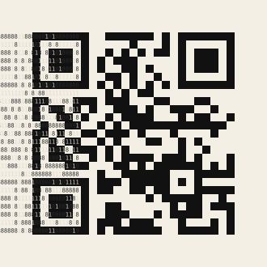
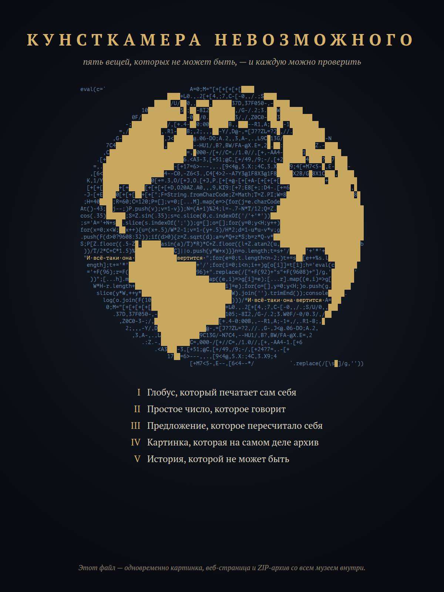

<div align="center">

# Кунсткамера невозможного

**Пять вещей, которых не может быть. Каждую можно проверить.**

[Открыть музей в браузере](https://moprety01-cpu.github.io/hoplite/) · `node verify.mjs`

</div>

> «Хочу, чтобы люди смотрели и учились».
> — Пётр I, основатель первой Кунсткамеры

В 1714 году Пётр I завёл в Петербурге Кунсткамеру — кабинет редкостей, куда пускали бесплатно, лишь бы смотрели. Эта Кунсткамера цифровая, и в ней пять экспонатов. Ни один из них не фокус: всё проверяется одной командой без единой зависимости (нужен только Node.js 22+) или прямо на [сайте музея](https://moprety01-cpu.github.io/hoplite/), где каждую проверку выполняет ваш браузер.

```sh
git clone https://github.com/moprety01-cpu/hoplite.git kunstkamera
cd kunstkamera && node verify.mjs
```

---

## I. Глобус, который печатает сам себя

```js
eval(c=`                          A=0;M="[+[+[+[+[████
                           ████+L0.,.2[+[4,;7,C-[-0,,/.;S████
                       █████/U/██0,,████.██████37D,37F050-,-█████
                   10██████████5█;██-8I2████████,/G-/.2;3.███W███████
                0F/██████████████-0██/0.████████3/,/,Z0C0-███3██████████
              -;███████████/,[+.4-██0:00██████B,,███--R1,A;████-1█████████
            =,/██████████,.R1-███B;,2;,,,██-Y/,D@-,=[J??ZL=?2█,//.██████████
          ,G-█████████████,J<██████@.06-DO;A.2,,3,A-,.,L9C█13G/█████████████-N
        7C4███████████████,████████--HU1/,B?,BW/FA-@X.E=,2█.██:██████████Z.-████
       ,C████████████████████████=,█000-/[+//C=,/1.0//,[+,-AA4-██████1███████████
     .[+████████████████████████6.<A3-3,[+51;@C,[+/49,/9;-/,[+2███████4████?██7████
    =,.██████████████████████-[+17=6>---,,.,[9<4@,5.X:;4C,3.X████9;4[+M7<5-█,E-████-
   ,[6<███████████████████4--C0,-Z6<3.,C4[4>2--A7Y3@1F8X3@1F8█████X2B/G█8X1C███,█████
  K,1/Y███████████████0[+=.3,O/[+J,O.[+J,P.[+[+@-[+[+A-[+[+[+[██████████████+█████████
  [+[+[█████+[+█████[+[+[+[+D,O20AZ.A0,,,9,KI9:[+7;E8[+;:D4-.[+=6███████████████████,█
 -J-[+E████0[+[+[██+[+[";F=String.fromCharCode;Z=Math;T=Z.PI;W=8█████████████████████8█
 ;H=40████;R=60;C=120;P=[];v=0;[...M].map(e=>{for(j=e.charCode█████████████████████████
At()-43;██j--;)P.push(v);v=1-v});N=(A+1)%24;l=-.7-N*T/12;Q=Z.███████████████████████████
cos(.35)██████;S=Z.sin(.35);s=c.slice(0,c.indexOf('/'+'*'))█████████████████████████████
;s='A='+N+s██.slice(s.indexOf(';'));g=[];o=[];for(y=0;y<H;y++)██████████████████████████
for(x=0;x<W;██x++){u=(x+.5)/W*2-1;v=1-(y+.5)/H*2;d=1-u*u-v*v;g██████████████████████████
.push(F(d>0?9608:32));if(d>0){z=Z.sqrt(d);a=v*Q+z*S;b=z*Q-v*████████████████████████████
S;P[Z.floor((.5-Z█.██████asin(a)/T)*R)*C+Z.floor((l+Z.atan2(u,█████████████████████████b
 ))/T/2*C+C*1.5)%████████████C]||o.push(y*W+x)}}n=o.length;t=s+'/█████'+'*'+███████████
 "И·всё-таки·она·█████████████вертится·";for(e=0;t.length<n-2;)t+=s██[e++%s.l██████████
  ength];t+='*'█████████████████████+'/';for(i=0;i<n;i++)g[o[i]]=t[i];h='eval(c███████
  ='+F(96);r=F(█████████████████████96)+".replace(/["+F(92)+"s"+F(9608)+"]/g,'███████'
   ))";[...h].m█████████████████████████ap((e,i)=>g[i]=e);[...r].map((e,i)=>g[███████
    W*H-r.length+████████████████████████████i]=e);for(o=[],y=0;y<H;)o.push(g.██████
     slice(y*W,++y*████████████████████████████W).join('').trimEnd());console█████.
       log(o.join(F(10█████████████████████████)))/*И·всё-таки·она·вертится·A=███
        0;M="[+[+[+[+[███████████████████████+L0.,.2[+[4,;7,C-[-0,,/.;S/U/0,,███
          .37D,37F050-,-█████████████████████105;-8I2,/G-/.2;3.W0F/-0/0.3/,/██
            ,Z0C0-3-;/,████████████████████[+.4-0:00B,,--R1,A;-1=,/,.R1-B;,█
              2;,,,-Y/,D███████████████@-,=[J??ZL=?2,//.,G-,J<@.06-DO;A.2,
                ,3,A-,.,L████████████9C13G/-N7C4,--HU1/,B?,BW/FA-@X.E=,2
                   .:Z.-,█████████C=,000-/[+//C=,/1.0//,[+,-AA4-1.[+6
                       .<A3███-3,[+51;@C,[+/49,/9;-/,[+24?7=,.-[+
                           17██=6>---,,.,[9<4@,5.X:;4C,3.X9;4
                                  [+M7<5-,E--,[6<4--*/           `.replace(/[\s█]/g,''))
```

Это не картинка, а программа на JavaScript, и она запускается:

```sh
node exhibits/1-globe/globe.js
```

Она печатает **новую программу**: ту же Землю, повёрнутую на 15°, то есть на час вперёд. Запустите напечатанное — получите следующий час. **Через 24 запуска программа возвращается к самой себе байт в байт.**

Океаны — это исходный код. Перед запуском программа выбрасывает пробелы и блоки суши `█`, склеивает остаток и выполняет. Континенты — просто дыры в коде. Где код кончается, океан дописывается комментарием, и в волнах плавает «И·всё‑таки·она·вертится».

```sh
node exhibits/1-globe/spin.mjs   # Земля вертится в терминале, каждый кадр — вывод предыдущего
```

Или вообще без вспомогательных скриптов:

```sh
cp exhibits/1-globe/globe.js /tmp/g.js
while :; do clear; cat /tmp/g.js; node /tmp/g.js > /tmp/n.js && mv /tmp/n.js /tmp/g.js; sleep .3; done
```

[Как это устроено →](exhibits/1-globe/)

## II. Простое число, которое говорит

<p align="center"></p>

Наведите на этот квадрат камеру телефона. QR-код скажет: **«Я простое число.»** И это правда.

Прочитайте 625 цифр строка за строкой, и получится одно число. Тёмные клетки — восьмёрки и девятки, светлые — единицы и семёрки. Число из одних восьмёрок и единиц чётное. Если заменить последнюю восьмёрку на девятку, число делится на 59. Из 624 способов поменять ещё одну цифру простое число даёт **ровно один**, и именно его вы видите.

Простота доказана строго: рядом лежит сертификат ECPP из 88 шагов.

```sh
node exhibits/2-prime/verify.mjs        # сам читает QR прямо из цифр и проверяет простоту (BPSW)
gp -q exhibits/2-prime/verify_cert.gp   # строгое доказательство в PARI/GP
```

[Как это устроено →](exhibits/2-prime/)

## III. Предложение, которое пересчитало себя

> В этом предложении ровно сорок две буквы «а», тридцать четыре буквы «б», сорок девять букв «в», одна буква «г», тридцать девять букв «д», двадцать одна буква «е», одна буква «ё», две буквы «ж», одна буква «з», одиннадцать букв «и», одна буква «й», тридцать шесть букв «к», две буквы «л», две буквы «м», девятнадцать букв «н», двадцать букв «о», шесть букв «п», пятнадцать букв «р», пять букв «с», тридцать пять букв «т», тридцать четыре буквы «у», одна буква «ф», одна буква «х», четырнадцать букв «ц», пять букв «ч», три буквы «ш», одна буква «щ», одна буква «ъ», четырнадцать букв «ы», двадцать две буквы «ь», две буквы «э», одна буква «ю» и девять букв «я».

Сосчитайте: каждое число верно. Предложение перечисляет все 33 буквы русского алфавита вместе с собой. Трудность в том, что числа сами состоят из букв: исправишь одно, и съедут другие. Решение нашлось после 38,9 миллиона шагов случайного поиска, и для этой формулировки оно, похоже, единственное.

```sh
node exhibits/3-autogram/verify.mjs
```

[Как это устроено →](exhibits/3-autogram/)

## IV. Картинка, которая на самом деле архив

<p align="center"></p>

Постер выше — это файл `kunstkamera.png`. Если переименовать его в `.html`, получится веб-страница. Если в `.zip`, получится архив со всем музеем.

```sh
unzip -l exhibits/4-chimera/kunstkamera.png
```

[Как это устроено →](exhibits/4-chimera/)

## V. История, которой не может быть

Посмотрите на историю этого репозитория:

```
$ git log --oneline --reverse
0000000 Кунсткамера невозможного: фундамент
0000001 Экспонат I. Глобус, который печатает сам себя
0000002 Экспонат II. Простое число, которое говорит
0000003 Экспонат III. Предложение, которое пересчитало себя
0000004 Экспонат IV. Картинка, которая на самом деле архив
0000005 Экспонат V. История, которой не может быть
0000006 Выставочный зал
0000007 Каталог и проверка всех экспонатов
```

Номер коммита — это SHA‑1 от его содержимого. Его нельзя выбрать, можно только угадать, и каждый такой номер — удача с шансом 1 к 268 435 456. Секрет спрятан в конце сообщения каждого коммита: там стоят 32 невидимых символа, пробелы и табуляции. Станок `mint.c` перебирает их сотни миллионов раз, пока хеш не станет нужным.

И ещё одна странность. Этот README лежит в коммите `0000007` и знает его номер заранее, хотя номер зависит в том числе от текста README.

```sh
node exhibits/5-history/verify.mjs   # пересчитывает SHA-1 каждого коммита и проявляет невидимые хвосты
```

[Как это устроено →](exhibits/5-history/)

---

## Устройство

```
index.html, site/      выставочный зал (GitHub Pages), все проверки — в браузере посетителя
verify.mjs             проверка всех пяти экспонатов
exhibits/1-globe/      globe.js, проигрыватель, исходник с комментариями, сборка и карта
exhibits/2-prime/      prime.txt, qr.svg, сертификат ECPP, генератор
exhibits/3-autogram/   autogram.txt, поиск на C
exhibits/4-chimera/    kunstkamera.png и его сборщик
exhibits/5-history/    mint.c — станок для хешей
```

Если ссылка на сайт не открывается, значит, GitHub Pages для репозитория ещё не включён. Включается так: *Settings → Pages → Deploy from a branch*, ветка по умолчанию, папка `/ (root)`. Локально сайт запускается командой `python3 -m http.server` в корне репозитория.

<sub>Кунсткамеру за один вечер, 9 ноября 2026 года, собрал ИИ в ответ на просьбу «удиви меня».</sub>
