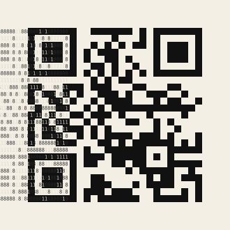

# Экспонат II. Простое число, которое говорит



Наведите камеру телефона на квадрат справа. QR-код скажет: **«Я простое число.»**

Это правда. Если прочитать 625 цифр строка за строкой, получится одно 625‑значное число, и оно простое.

- Тёмные клетки — это цифры `8` и `9`, светлые — `1` и `7`. Перед вами QR-код версии 2 (25×25, коррекция ошибок L, маска 5). Он кодирует 29 байт UTF‑8.
- «Чистое» число из одних восьмёрок и единиц простым быть не может. Правый нижний модуль тёмный, значит, число кончается на 8 и оно чётное.
- Заменим последнюю 8 на 9. Получится число, которое делится на 59.
- Остаётся заменить ещё одну цифру: 1→7 или 8→9. Из 624 вариантов простым оказывается **ровно один**: семёрка в 12‑й строке, 1‑м столбце. Его вы и видите. Это число равно «чистому» плюс 6·10³⁴⁹ + 1.

## Доказательство

Вероятностные тесты (Миллер — Рабин и строгий тест Люка, вместе BPSW) убеждают, но не доказывают. Поэтому рядом лежит сертификат простоты ECPP (`prime.cert.gp`). Это цепочка из 88 эллиптических кривых, каждая из которых сводит простоту числа к простоте меньшего. PARI/GP 2.15 построил её за 14 секунд. Проверка занимает доли секунды, и проверить её может кто угодно:

```sh
node exhibits/2-prime/verify.mjs        # сам читает QR из цифр (вплоть до Рида — Соломона) + BPSW
gp -q exhibits/2-prime/verify_cert.gp   # строгая проверка сертификата
```

## Файлы

| файл | что это |
|---|---|
| `prime.txt` | число: 25 строк по 25 цифр |
| `qr.svg` | то же число в виде QR-кода; цифры в SVG можно выделить и скопировать |
| `prime.cert.gp` | сертификат ECPP |
| `verify.mjs` | проверка: читает QR из цифр и прогоняет тесты простоты; работает и в Node, и в браузере |
| `verify_cert.gp`, `make_cert.gp` | проверка и построение сертификата в PARI/GP |
| `make_prime.py` | воспроизводит всё с нуля: QR (segno), поиск, SVG, проверку сканируемости (zxing) |

Цвета цифр в клетках подобраны так, чтобы сканеры (ZXing, камеры телефонов) не принимали штрихи цифр за модули. На отрисовках от 4 до 64 пикселей на модуль код читается без ошибок.
