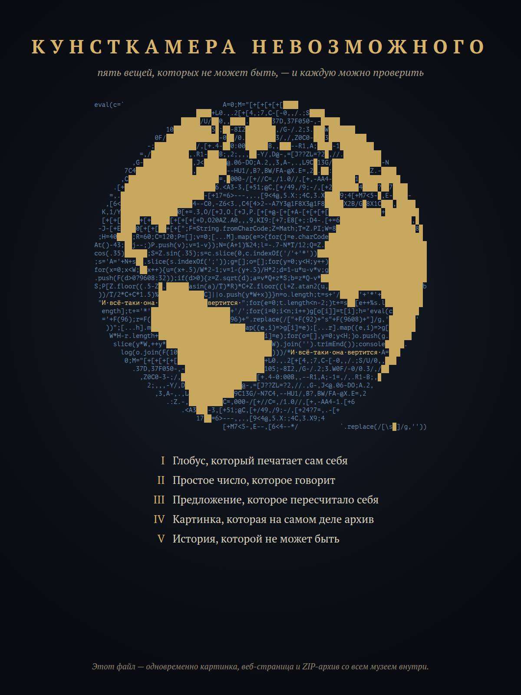

# Экспонат IV. Картинка, которая на самом деле архив



`kunstkamera.png` — постер музея. Это один файл, и он устроен так, что его можно читать тремя способами:

- **картинка**: откройте его как обычно;
- **веб-страница**: переименуйте в `kunstkamera.html` и откройте в браузере, страница расскажет о себе и покажет саму себя как картинку;
- **ZIP-архив со всем музеем**: переименуйте в `kunstkamera.zip` и распакуйте, или сразу `unzip -l exhibits/4-chimera/kunstkamera.png`.

```sh
node exhibits/4-chimera/verify.mjs   # PNG, HTML и ZIP: все контрольные суммы
file exhibits/4-chimera/kunstkamera.png && unzip -t exhibits/4-chimera/kunstkamera.png
```

## Как это возможно

Каждый формат читает файл со своей стороны:

```
┌──────────┬──────┬───────────────┬──────────────────────────────┬──────┬──────────────────────┐
│ PNG-сиг- │ IHDR │ htMl          │ IDAT … IDAT                  │ IEND │ ZIP: файлы, каталог, │
│ натура   │      │ (веб-страница)│ (пиксели постера)            │      │ конец каталога       │
└──────────┴──────┴───────────────┴──────────────────────────────┴──────┴──────────────────────┘
  ← PNG читается отсюда                                                ZIP читается отсюда →
```

- **PNG** состоит из фрагментов (чанков). Чанк, имя которого начинается со строчной буквы, необязательный: если программа его не знает, она его пропускает. Страница лежит в таком чанке с именем `htMl`. Вторая строчная буква в имени означает «частный», а последняя — «можно копировать».
- **ZIP** читают с конца: программа ищет запись «конец каталога», а по ней — сам каталог. Архив дописан после `IEND`, последнего чанка картинки, и все смещения в нём посчитаны от начала файла. Поэтому `unzip` видит совершенно обычный архив, без предупреждений.
- **HTML** прощает всё. Перед страницей в файле стоит 41 байт двоичного мусора: сигнатура PNG, заголовок и длина чанка. Их прячет CSS. Всё, что идёт после страницы (пиксели и архив), проглатывает невидимый элемент `<plaintext>`: всё, что стоит после него, браузер считает простым текстом до самого конца файла.

Сборщик (`build.mjs`) рисует постер в headless Chrome по шаблону `poster.html`. Глобус на постере — это настоящий `globe.js` из экспоната I. Затем сборщик вшивает `page.html` и дописывает архив из всех файлов репозитория, кроме самого постера. Даты в архиве зафиксированы, поэтому архив собирается одинаково при каждом запуске.

| файл | что это |
|---|---|
| `kunstkamera.png` | экспонат |
| `build.mjs` | сборка (Node.js без зависимостей + google-chrome для рисования постера) |
| `poster.html`, `page.html` | постер и страница |
| `verify.mjs` | проверка всех трёх прочтений |
